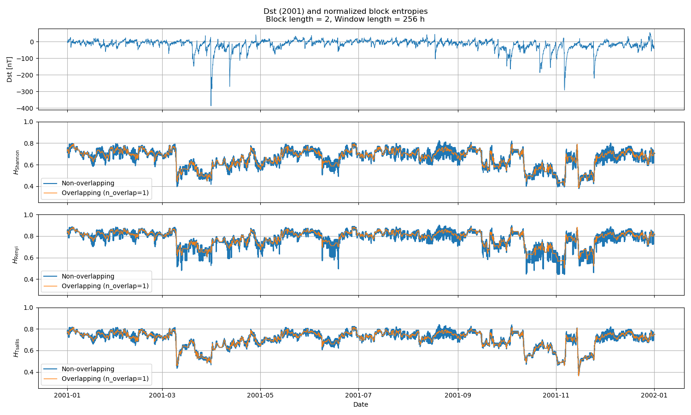

# Entropy Analysis

A Python project for the calculation and analysis of information-theoretic entropy measures, with applications to geomagnetic time series.

The project includes implementations of Shannon, Rényi, and Tsallis entropy, binary symbolic dynamics, analytical validation tests, and an example using the geomagnetic Dst index.

## Features

### Entropy measures (`entropy.py`)

- **Shannon entropy**: Entropy of a discrete probability distribution, with optional normalization. $$ \mathrm{H}_{\mathrm{Shannon}} = - \sum_i p_i \, \log_b(\,p_i\,)$$
- **Rényi entropy**: Rényi entropy with order parameter $\alpha$. $$ \mathrm{H}_{\mathrm{Renyi}} = \frac{1}{1-\alpha} \ln \left(  \sum_i p_i^\alpha\,\right)$$
	When $\alpha\rightarrow 1$,  Rényi entropy is in the Shannon entropy limit.
- **Tsallis entropy**: Tsallis entropy with entropic index $q$ and scaling constant k. $$ \mathrm{H}_{\mathrm{Tsallis}} = \frac{k}{q-1} \left(1-\sum_i p_i^q\,\right)$$
	When $q\rightarrow 1$,  Tsallis entropy is in the Shannon entropy limit.
- **Histogram probabilities**: Estimate probability distributions from observations.
- **Time-series entropy**: Calculate Shannon entropy directly from a time series using histogram bins.    

### Symbolic dynamics (`symbolic_dynamics.py`)

- **Binary digitization**: Convert time-series measurements into binary symbols (0,1) using a threshold.
- **Lumping method**: Estimate probabilities of non-overlapping binary blocks.
- **Overlapping method**: Estimate block probabilities using overlapping windows with adjustable overlap.

Blocks containing NaN values are excluded from probability estimation.

## Example: Dst Geomagnetic Index (2001)

The example in `examples/Dst2001.py` applies symbolic entropy analysis to hourly Dst measurements from 2001, following aspects of the methodology described by Balasis et al. (2009). 

The analysis uses:
- A moving window of 256 hours, advancing by one hour.
- Binary digitization using the mean Dst value within each window.
- Binary blocks of length 2.
- Non-overlapping and overlapping block probability estimation.
- Normalized Shannon, Rényi (α = 0.5), and Tsallis (q = 1.8) entropy.

The resulting entropy measures are plotted alongside the original Dst time series.


 

**Reference:** Balasis, G., Daglis, I. A., Papadimitriou, C., Kalimeri, M., Anastasiadis, A., & Eftaxias, K. (2009). *Investigating dynamical complexity in the magnetosphere using various entropy measures*. Journal of Geophysical Research: Space Physics, 114(A9), A00D06. https://doi.org/10.1029/2008JA014035


### Data source

Hourly Dst measurements were obtained from NASA's OMNIWeb (https://omniweb.gsfc.nasa.gov/form/dx1.html).

The original 2001 dataset and its format description are included in `data/dst/`.

## Requirements

- Python 3
- NumPy
- Matplotlib

## Usage

Clone or download the repository. From the repository's root directory, run the Dst example:

```
python -m examples.Dst2001
```

The example loads the included Dst data and produces plots of the geomagnetic index and normalized entropy measures.

## Validation

The `tests/` directory contains analytical tests for the entropy and symbolic dynamics functions.

The tests cover probability distributions with known entropy values, binary digitization, block probability estimation, overlapping and non-overlapping blocks, missing values, and selected invalid inputs.

Run the tests from the repository's root directory:

```
python -m tests.test_entropy
python -m tests.test_symbolic_dynamics
```

